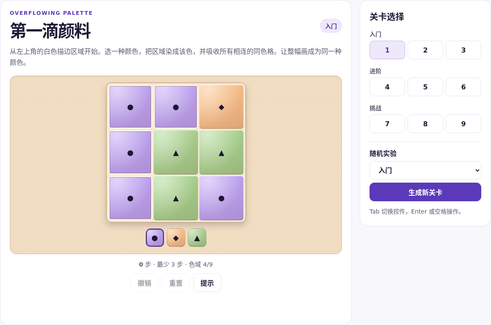
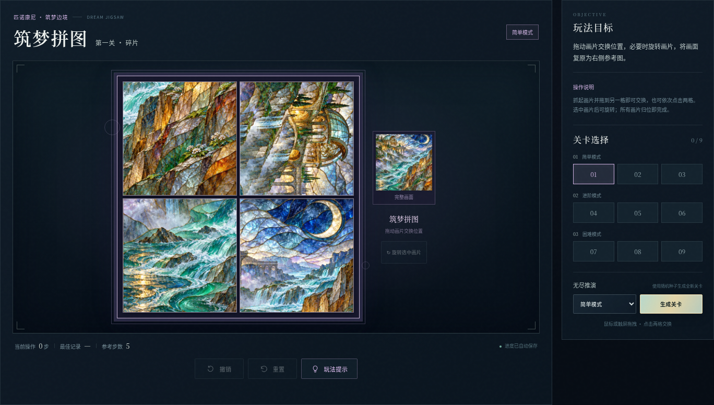
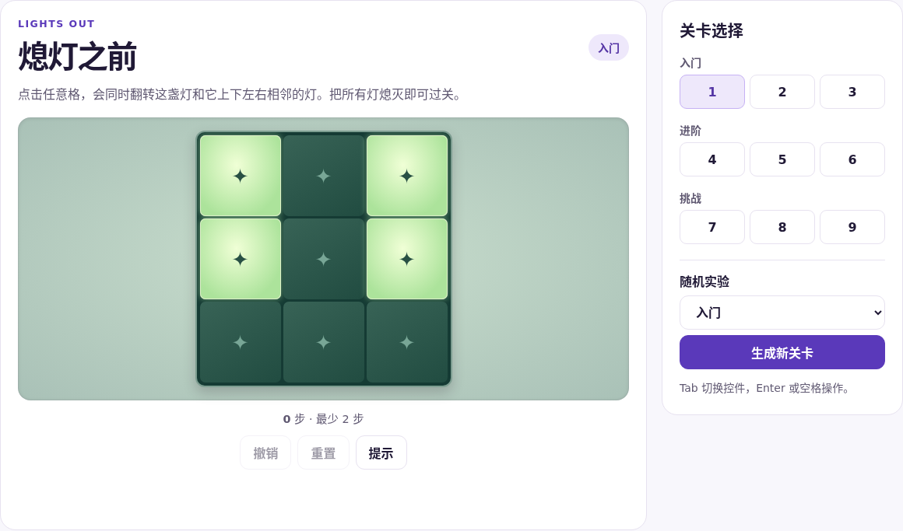
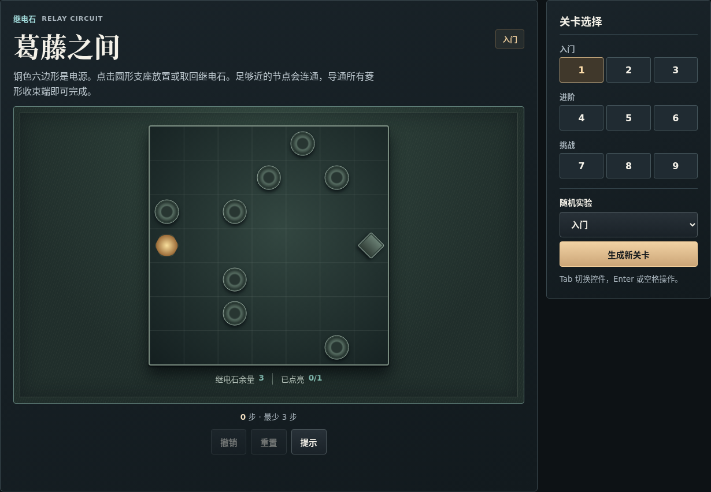

# Game Lab · 机关玩法合集

**[在线开玩](https://gaomengyang.com/puzzle-lab/)**

Game Lab 是非商业、非官方的游戏机关玩法研究项目，仅用于探索、学习与致敬。项目以原创程序、场景、界面和固定关卡呈现八种机制，每种玩法包含九道固定关卡、三档随机关卡、分级提示与浏览器本地进度。


## 收录玩法

| 游戏 | 玩法与操作 | 机制参考 |
| --- | --- | --- |
| 匣里流光 | 旋转承接器，实时校准光路，经过所有建木花枝并抵达终点 | 《崩坏：星穹铁道》公输师傅的匣里流光 |
| 庸人的容器 | 推动军械箱，打通前往受困者位置的道路 | 《崩坏：星穹铁道》愚者之箱 |
| 枘凿六合·Remake | 搭建资源块，让立体的三面投影同时吻合 | 《崩坏：星穹铁道》庙趣满堂 |
| 筑梦拼图 | 拖拽交换、旋转画片，复原完整画面 | 《崩坏：星穹铁道》匹诺康尼筑梦拼图 |
| 黄金替罪羊 | 记录脚步，让黑暗复现并压住机关，自己抵达祭坛 | 《崩坏：星穹铁道》翁法罗斯 |
| 溢彩画 | 先选颜料再点画格，利用连通扩散在限步内染成目标色 | 《鸣潮》溢彩画 |
| 继电石 | 放置或取回继电石，将电流从放电石传导至所有聚电石 | 《原神》稻妻导电机关 |
| 熄灯 | 触发自身与四邻的状态翻转，使矩阵全部熄灭 | 经典 Lights Out 番外玩法 |

各款游戏采用独立的材质、色彩、场景与通关反馈。项目对机制进行了适合浏览器短局的抽象，并非原作关卡、角色或剧情的复制。

## 实机画面

以下截图由自动化浏览器验收在实际游玩页面上生成。

<!-- screenshot-gallery:start -->

### 匣里流光


### 溢彩画



### 庸人的容器


### 枘凿六合·Remake


### 筑梦拼图



### 黄金替罪羊


### 熄灯



### 继电石



<!-- screenshot-gallery:end -->

移动端首页与拼图实机画面：[首页](docs/screenshots/mobile-home.png) · [筑梦拼图](docs/screenshots/mobile-mosaic.png)。

## 本地运行

在项目根目录运行：

```sh
python3 -m http.server 8174 --bind 127.0.0.1 --directory public
```

打开 <http://127.0.0.1:8174/>。应用没有运行时依赖、构建步骤或后端，可直接部署 `public/` 到静态站点，支持子目录部署。

- 鼠标与触屏可直接操作机关；筑梦拼图支持连续拖拽。
- 移动类玩法支持方向键、滑动、点击相邻格与屏幕方向按钮；黄金替罪羊可用等待按钮。
- 溢彩画先选择右侧颜料，再点击画框中的格子。
- 提示分为玩法策略、标出位置、执行一步。最佳记录包含执行提示的动作。
- 设置中可减少动态效果，或为溢彩画显示颜色辅助图案。

首次在线加载成功后，静态资源会保存到浏览器。页脚出现「可离线游玩」后，可断网重新进入。安装入口由浏览器提供，需使用 localhost 或 HTTPS。进度保存在当前浏览器与站点地址下，旧版本进度会自动迁移。

## 验证与部署

```sh
npm test                       # Node.js 22 或更新版
gjs -m tests/engines.test.js    # 或使用 GNOME JavaScript
gjs -m tests/app-smoke.test.js
```

浏览器验收使用 Playwright，会启动临时本地服务，自动通关八款游戏，检查键盘、鼠标、触屏、320/390/768 像素布局、存档和离线重开，并在通过后更新本文实机截图：

```sh
python -m pip install playwright
python -m playwright install chromium
python scripts/acceptance.py
```

也可通过 `PUZZLE_LAB_BROWSER_EXECUTABLE` 指定本机 Chrome/Chromium 可执行文件。GitHub Actions 会运行引擎测试与 Chromium 端到端检查，检查通过的 `main` 版本会自动发布到 GitHub Pages，部署路径继续保持 `/puzzle-lab/`。

- [玩法调研与规则取舍](docs/research.md)
- [开发与状态接口](docs/development.md)

## 版权与来源

Game Lab 是独立制作的非官方项目，与任何原作发行方或开发方无合作、授权或背书关系。原作名称、商标、角色、美术、音乐、故事、原关卡及其他受保护内容，其权利均归各自原权利人所有。参考作品包括米哈游／HoYoverse 的《崩坏：星穹铁道》《原神》，库洛游戏／Kuro Games 的《鸣潮》，以及经典益智游戏 Lights Out。名称仅用于标明玩法参考。

本项目使用原创程序、关卡、界面与场景。入口的机关场景和筑梦拼图的艺术玻璃画为本项目原创图像，未收入原作画面、角色、模型或音频。外部攻略、视频与公开玩法说明仅用于机制研究和溯源，详细出处见[玩法调研](docs/research.md)。
