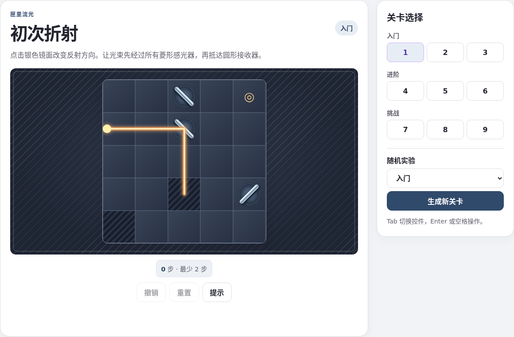
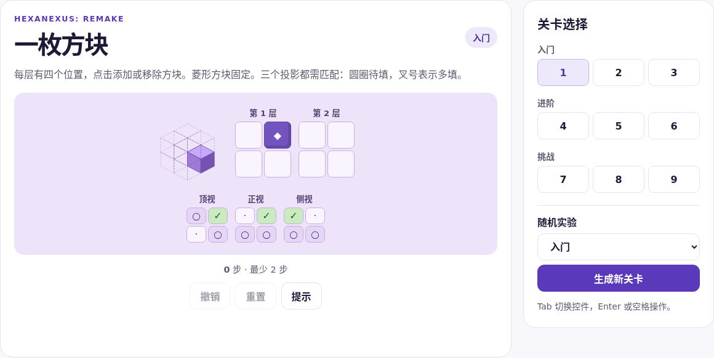
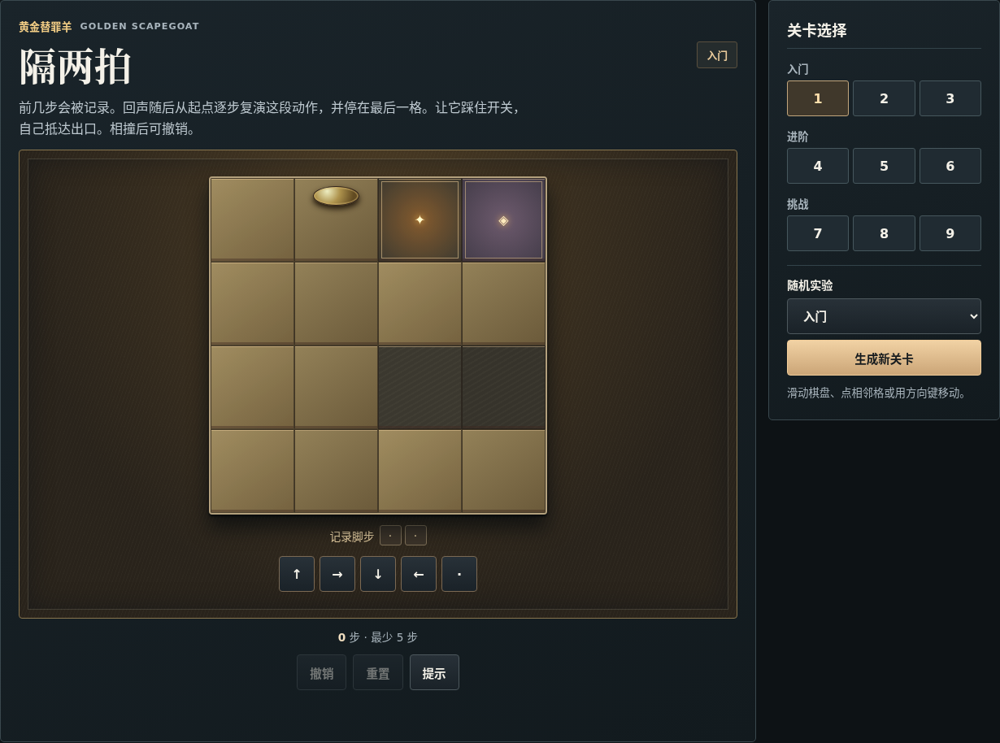

# Puzzle Lab · 谜题实验室

**[在线开玩](https://gaomengyang.com/puzzle-lab/)**

Puzzle Lab 是一个非官方小游戏复刻项目，用来学习原作的解谜设计，也向它们致敬。打开网页就能玩。七个小游戏各有九道固定关卡、三档随机题，进度保存在浏览器。

| 游戏 | Puzzle Lab 玩法 | 参考来源 |
| --- | --- | --- |
| 匣里流光 | 转动镜面，点亮沿途感光器并照亮终点 | 公输师傅的匣里流光 |
| 溢彩画 | 合并同色区域，染满整张棋盘 | 鸣潮溢彩画、经典 Flood |
| 庸人的容器 | 推开障碍箱，走到营救点 | 崩坏：星穹铁道 · 愚者之箱 |
| 枘凿六合·Remake | 填充体素使三面投影吻合 | 崩坏：星穹铁道 · 庙趣满堂 |
| 梦境拼图 | 换位并旋转打散的原创画片 | 崩坏：星穹铁道 · 匹诺康尼 |
| 黄金替罪羊 | 规划脚步，让延迟回放的同伴踩中开关 | 崩坏：星穹铁道 · 翁法罗斯 |
| 熄灯 | 翻转灯与四邻，让整块棋盘熄灭 | 经典 Lights Out、稻妻联动机关 |

## 实机画面

<!-- screenshot-gallery:start -->

### 匣里流光



### 溢彩画


### 庸人的容器


### 枘凿六合·Remake



### 梦境拼图


### 黄金替罪羊



### 熄灯


<!-- screenshot-gallery:end -->

## 本地运行

在项目根目录运行：

```sh
python3 -m http.server 8174 --bind 127.0.0.1 --directory public
```

打开 <http://127.0.0.1:8174/>。鼠标与触屏直接操作控件。键盘可用 Tab 和 Enter，移动游戏还支持方向键，黄金替罪羊可用等待按钮。帮助分为策略、标出位置、执行一步。最佳步数包含执行提示的动作。

首次在线加载成功后，应用将静态文件保存到本地。页脚出现「可离线游玩」后，可断网重新进入。安装入口由浏览器提供，需使用 localhost 或 HTTPS。进度保存在当前浏览器和站点地址下。

## 验证与部署

```sh
npm test                       # Node.js 22 或更新版
gjs -m tests/engines.test.js    # 或使用 GNOME JavaScript
gjs -m tests/app-smoke.test.js
```

浏览器验收需另装 Playwright。以下命令会自动启动临时本地服务，并在验收通过后更新 README 截图：

```sh
python -m pip install playwright
python -m playwright install chromium
python scripts/acceptance.py
```

直接把 `public/` 内容部署至任意 HTTPS 静态站点，支持子目录部署。应用没有运行时依赖、构建步骤或后端。GitHub Actions 工作流会运行引擎测试与 Chromium 端到端检查。仓库变量 `PUZZLE_LAB_PAGES_ENABLED=true` 启用自动发布，通过检查的 `main` 版本会部署到 GitHub Pages。

- [玩法调研与取舍](docs/research.md)
- [开发文档](docs/development.md)

## 版权与来源

Puzzle Lab 是独立制作的非官方项目，与任何原作发行方或开发方无合作、授权或背书关系。原作名称、商标、角色、美术、音乐、故事、原关卡及其他受保护内容，其权利均归各自原权利人所有。参考作品包括米哈游／HoYoverse 的《崩坏：星穹铁道》《原神》，库洛游戏／Kuro Games 的《鸣潮》，以及经典益智游戏 Lights Out。名称仅用于标明玩法参考。

本项目采用原创程序、关卡数据和界面图形。对外部攻略、视频与开源项目的引用用于研究及溯源，各资料仍受其原权利及许可约束。详细出处见[玩法调研](docs/research.md)。
